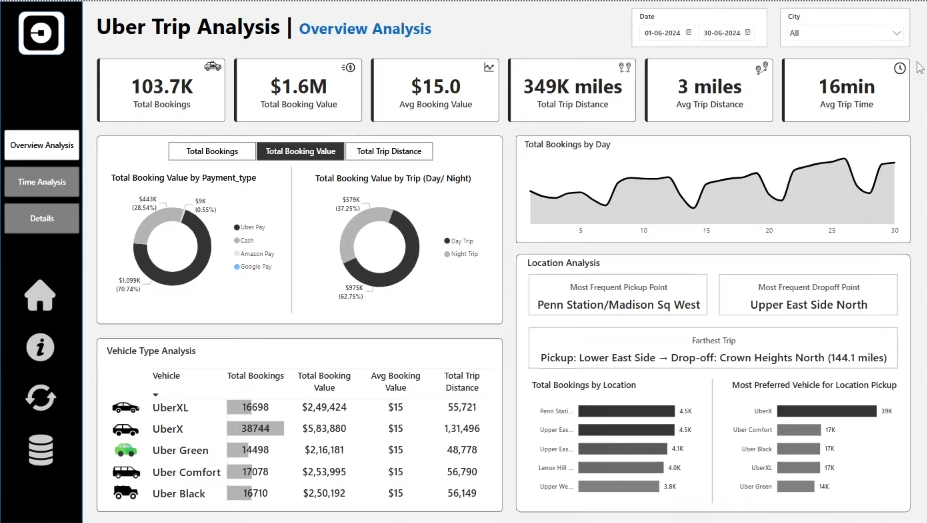

Uber Trip Analysis Dashboard | Power BI

An interactive Power BI dashboard that explores Uber booking trends, revenue, trip efficiency, and ride demand to support data-driven business decisions.

📊 Dashboards

1. Overview Analysis

- KPIs: Total Bookings, Total Booking Value, Average Booking Value, Total Trip Distance, Average Trip Distance, and Average Trip Time.
- Dynamic analysis by payment type, trip type (Day/Night), and vehicle type.
- Location insights: most frequent pickup and drop-off points, top 5 booking locations, and farthest trip.
- Daily booking trends and vehicle performance comparisons.

2. Time Analysis

- Pickup-time trends in 10-minute intervals.
- Booking patterns by day of the week.
- Hour-by-day heatmap to identify peak and off-peak demand.
- Dynamic measures across visualizations.

3. Trip Details

- Detailed trip records with drill-through functionality.
- Bookmarks to switch between filtered records and the full dataset.

⚡ Key Features

- Dynamic measure selection and chart titles.
- Interactive date and city slicers.
- Conditional formatting and custom tooltips.
- Clear Filters button and data-details bookmarks.

🛠️ Tech Stack

"Power BI" · "DAX" · "Power Query" · "Data Modeling"

🎯 Objective

Uncover booking and revenue patterns, understand customer travel behavior, identify demand peaks, and explore opportunities to improve pricing and operational efficiency.
